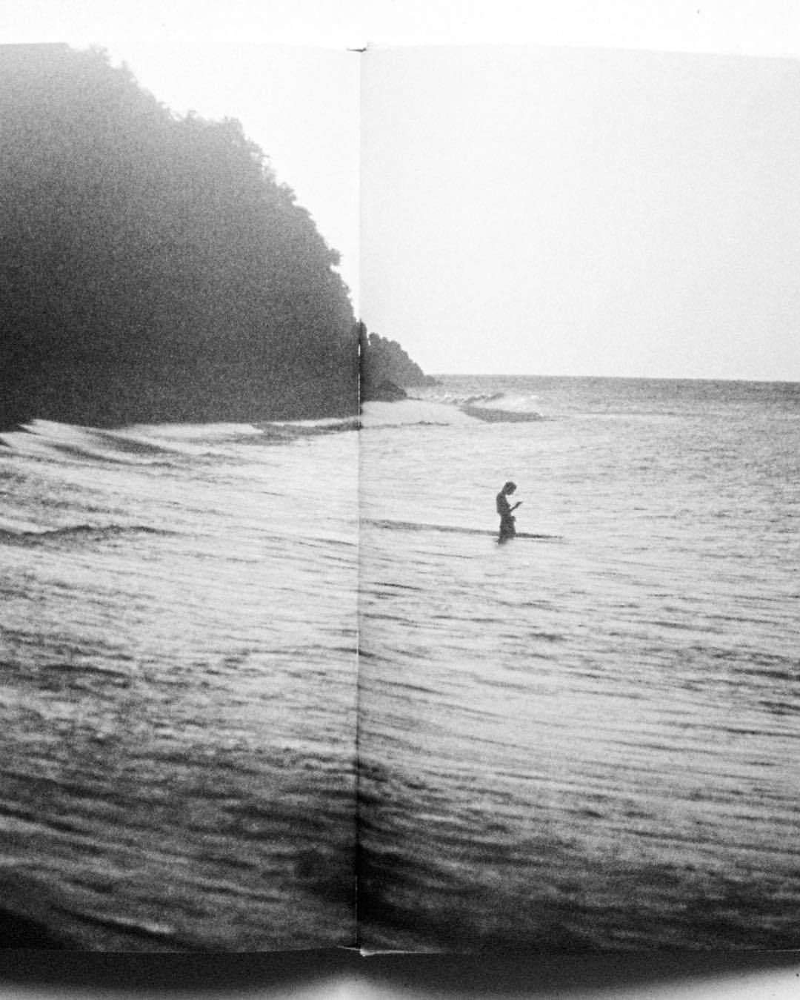
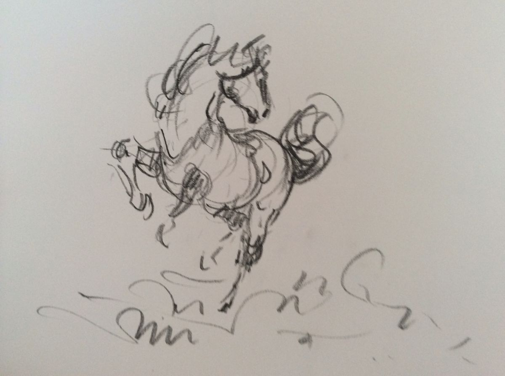
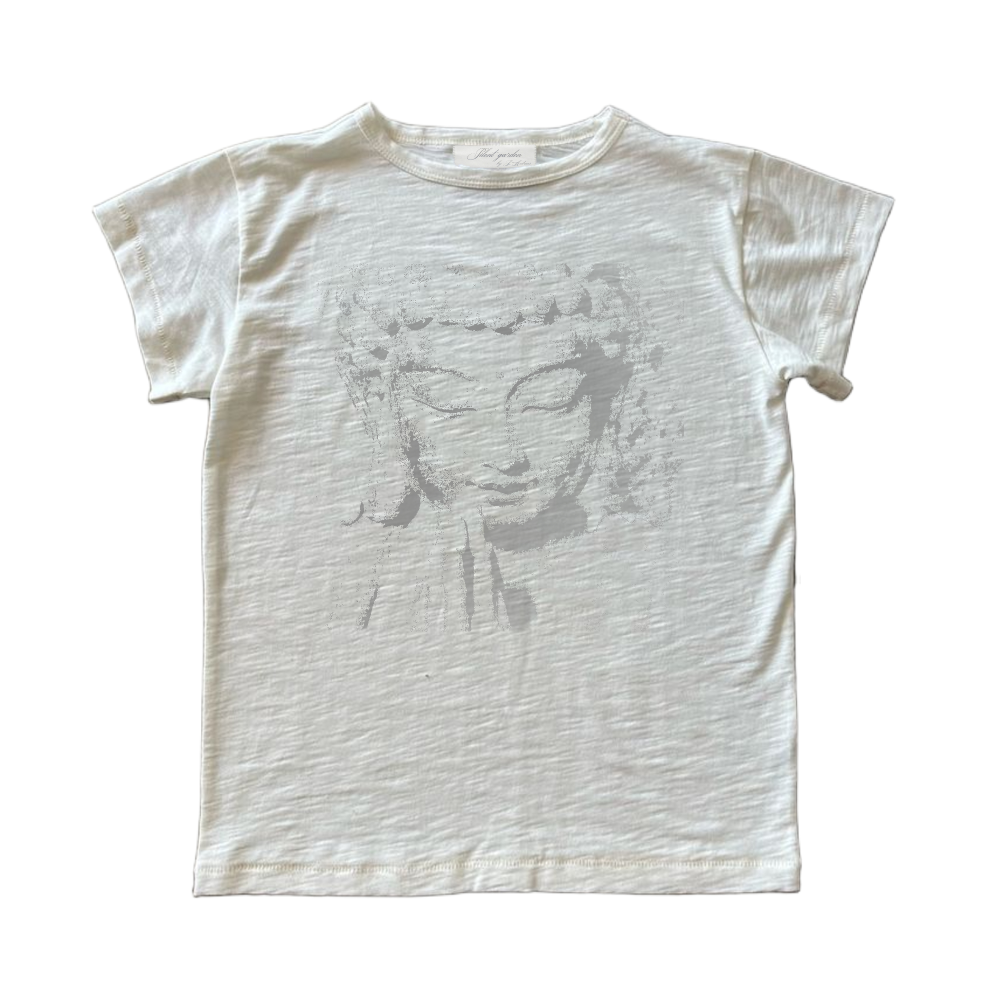
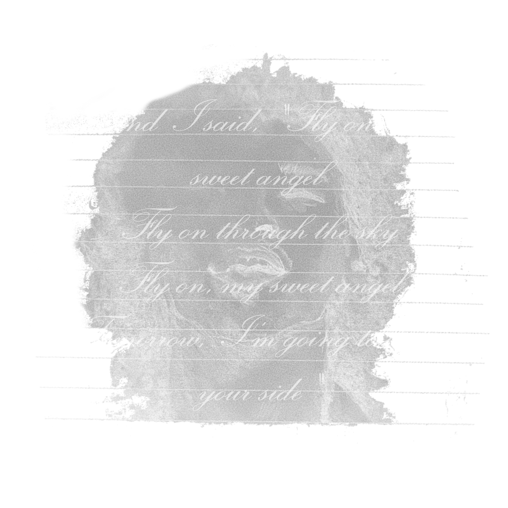
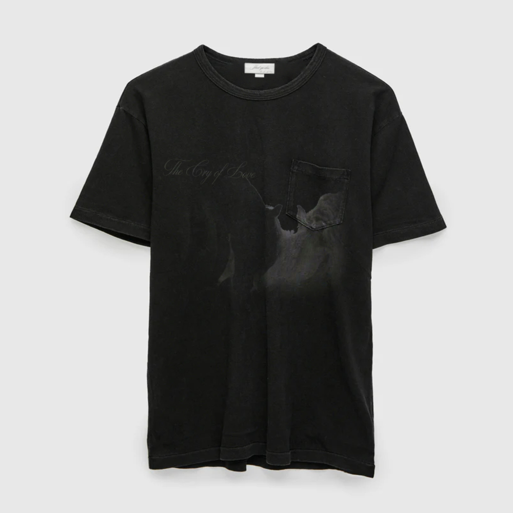

Founded in 2025, Silent Garden is a clothing brand concept inspired by sophisticated vintage fashion, timeless silhouettes and understated individuality.

---

## About Us

Inspired by vintage clothing, traditional materials and everyday life, our garments explore the balance between nostalgia and modern simplicity. We are deeply influenced by the environments we pass through, and the experiences we gather from different cultures and places.

## Design Language

| Element | Direction |
| :--- | :--- |
| Colour palette | Ivory, espresso brown, olive and faded black |
| Silhouettes | Relaxed, straight and classic |
| Inspiration | Vintage pieces and understated tailoring |

## The Archive

A collection of visual references and concept designs exploring vintage graphics, traditional artwork and the imperfect character of analogue photography.

## SG_01 — Concept Collection

The first collection is a conceptual exploration of everyday essentials.

1. **Snow Leopard Denim** — classic straight-leg denim cut with added details.
2. **Poem T-Shirt** — slub cotton tee with vintage character.
3. **Sage Knit** — a simple knitwear piece in a muted, earthy colour.

These pieces represent the proposed direction of the brand rather than products currently available for sale.

---
